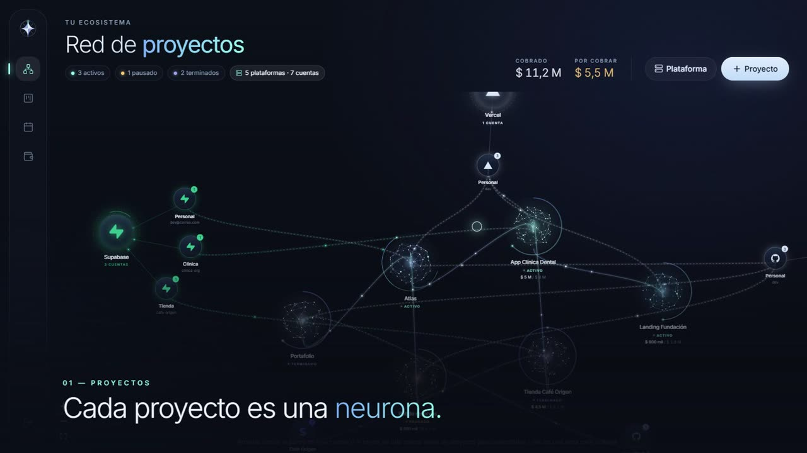

<div align="center">


# atlas

**Tu mapa personal para todo lo que construyes.**

Proyectos, tareas, agenda y finanzas conectados en un solo lugar.



</div>

## Qué hace

- **Red de proyectos:** cada proyecto es una esfera animada conectada a las plataformas que usa (Supabase, Vercel, GitHub…) y a sus cuentas.
- **Dinero por proyecto:** monto negociado, pagos recibidos y cuánto falta por cobrar.
- **Tareas:** tablero tipo Kanban con prioridades, checklist y fechas límite.
- **Calendario:** sincronizado con Google Calendar, junto con las fechas de tus tareas.
- **Finanzas:** regla 50/30/20, presupuestos por categoría y metas de ahorro.

## Stack

React · TypeScript · Tailwind CSS · React Flow · Fastify · Supabase · Vercel · Google Calendar API

## Correrlo

Los pasos para configurar Supabase, Google y Vercel están en [SETUP.md](SETUP.md).

```bash
cd backend && npm install && npm run dev
cd frontend && npm install && npm run dev
```

---

<sub>Proyecto personal, diseñado y desarrollado de punta a punta.</sub>
